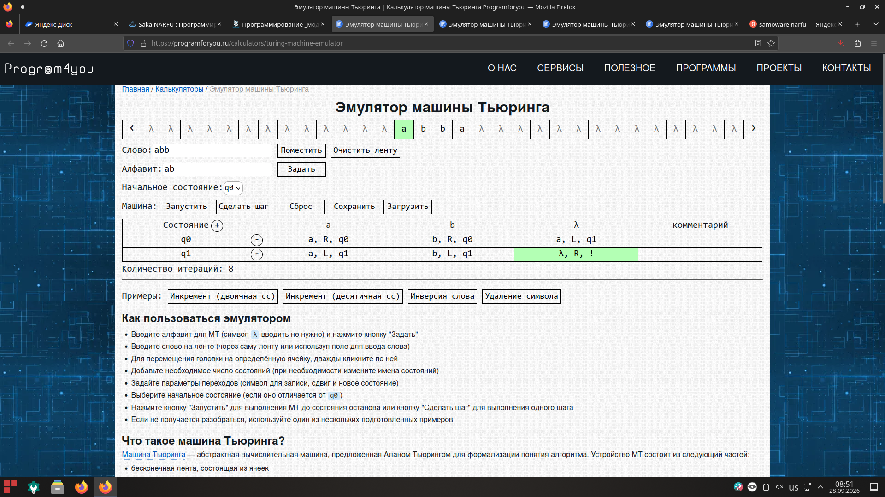
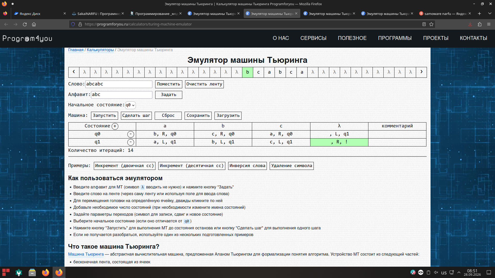
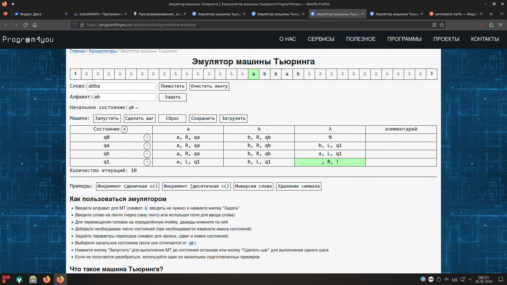
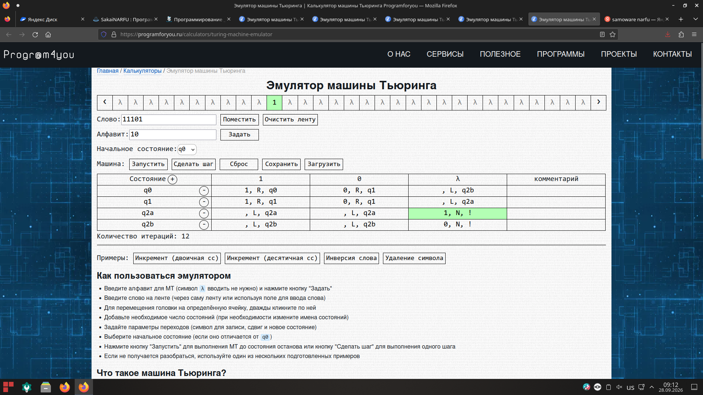

# LR2
Лабораторная работа направлена на изучение и понимание алгоритмов через машину Тьюринга

– алфавит A;
– непустое слово P, состоящее из символов алфавита A (если P является двоичной записью числа,
то оно не содержит лидирующих нулей и является целым неотрицательным). 
## Задание 1
A = {a, b}. Добавить в конец символ a

Идем направо до пустого символа, затем добавляем "а" и идем в обратную стороную. 
## Задание 2
 A = {a, b, c}. Заменить каждый символ на следующий по алфавиту (abcacb → bcabac).

 
 Идем направо, меняя каждый символ на следующий по алфавиту, пока не дойдем до пустого символа. Затем возвращаемся влево.
 ## Задание 3
 A = {a, b}. Добавить в конец символ, отличающийся от последнего символа слова P.

 
 Создаем два состояние, чтобы запомнить последний символ. Если последний символ "а", то добавляем "b" и наоборот. Затем возвращаемся назад. 
 ## Задание 4
A = {a, b}. Переместить первый символ в конец (abbaab → bbaaba).

Запоминаем первый символ, при помощи создания двух состояний, проходим направо и добавляем его в конец. Возвращаемся назад.
## Задание 5
A = {0, 1}. Считая слово P записью числа в двоичной системе, проверить, содержит ли оно нули.
Если да, на ленте должен остаться только символ 1, в противном случае – символ 0 (1011 → 1,
11111 → 0).

Создаем четыре состояния. Первым проходисмя по слову. Если нулей нет, то переходим  впоследниее состояние, которое справа налево удаляет все симолы и ставит на ленту 0. 

Если встречаем 0, то переходим во второе состояние, которое доходит до конца и на пустом символе переходит в третье состояние. Оно также .удаляет все символы и ставит на ленту 1.
## Задание 6 (Вариант 18)
A = {a, b, c}. Удалить первый и последний символы слова P, если они разные; в
противном случае заменить последний на любой другой (cbcab → bca, cbc → cba).

.png)
Программа удаляет первый символ и доходит до конца слова. Если символы совпадают, то она меняет последний символ на следующий по алфавиту. Если разные, то удаляет последний символ и возвращается налево. 